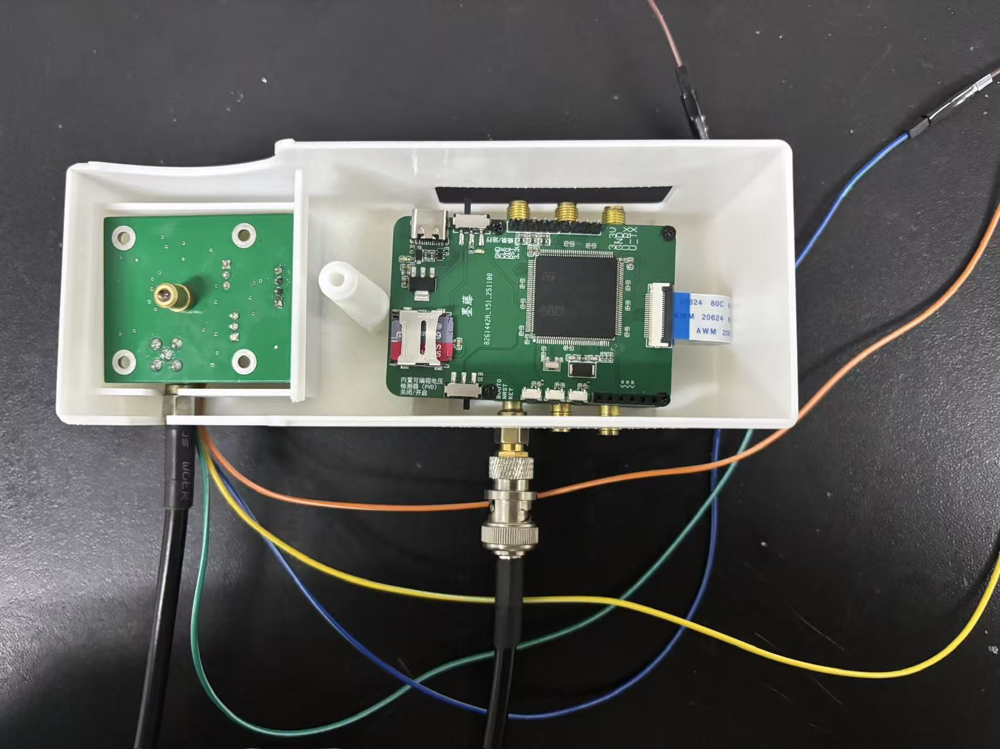

# 陈一丹的工程项目作品集

北京工业大学 · 面向 IC 设计方向学习 · 设备通信、信号处理与机器人视觉项目实践。

**当前学习状态：** 本学期开始学习 Verilog / SystemVerilog 和 FPGA，尚无独立 RTL / FPGA 项目。下面两个项目展示既有系统工程经历。

[个人首页](https://chenyidan2006.github.io/laser-self-mixing-vascular-portfolio/home.html) · [SMI 项目](https://chenyidan2006.github.io/laser-self-mixing-vascular-portfolio/) · [道路识别](https://chenyidan2006.github.io/laser-self-mixing-vascular-portfolio/road-recognition.html)

## 30 秒了解我的项目

| 项目 | 我负责的部分 | 团队成果 | 深入阅读 |
| --- | --- | --- | --- |
| 激光自混合干涉（SMI）血管参数测量 | App 全部前后端、ESP32 到服务器通信、算法重训练与优化 | 光电设计竞赛华北区一等奖；国创项目进行中 | [技术证据](docs/PROJECT_EVIDENCE.md#smi) |
| 城市道路识别深度学习小车 | 队长；U-Net 训练调参与 detect_line3.py 感知参数标定 | 第二十八届中国机器人及人工智能大赛全国总决赛，机器人应用赛（城市道路识别）三等奖 | [技术证据](docs/PROJECT_EVIDENCE.md#road) |



## 课程基础

- **已修：** C 语言、Java、数据结构与算法、电路与系统、电子电路、固体电子学、数字电路、电磁学Ⅰ、线性代数、概率与统计。
- **在修：** 数字系统设计、微控制器、信号与系统、电子线路与原理、操作系统、电磁学Ⅱ。
- **本学期开始学习：** Verilog / SystemVerilog、FPGA。课程学习不等于已具备独立芯片设计或验证经验。

## 可以从这些问题开始交流

- SMI：40 kHz、16 bit 与 8 秒记录，怎样换算负载和串口带宽？如何区分采集、上传与模型输入时长？
- 道路识别：分割掩膜怎样变成车道误差？如何调整滑动窗口？为什么不能将控制循环频率视为模型帧率？
- IC 学习：将设备通信经历转化为 UART RX 与同步 FIFO 的设计规格，再补充 RTL、testbench 和 FPGA 验证。

[面试准备提纲](docs/INTERVIEW.md) · [IC 实践计划（尚未完成）](docs/IC_LEARNING_PLAN.md)

## 仓库内容

```text
 dist/                      静态网站、实物照片、证书与界面截图
   home.html                个人首页
   index.html               SMI 项目详情（保留旧网址）
   road-recognition.html    城市道路识别详情
   engineering.html         工程证据与IC学习方向
 docs/                      事实依据、面试准备、学习计划与维护记录
 scripts/check_site.py      本地页面、资源与锚点检查
 .github/workflows/          网站静态检查
 ASSET_CREDITS.md            图片来源与修饰说明
```

本仓库保存作品集网站。SMI 实现代码位于[独立项目仓库](https://github.com/chenyidan2006/laser-self-mixing-vascular-monitoring)。道路识别代码目前是本地历史资料，完整 ROS 环境、模型和数据集尚未整理为公开复现包。

## 本地查看

使用 Python 3，无须安装前端依赖：

```powershell
python scripts/check_site.py
python -m http.server 4173 --bind 127.0.0.1 --directory dist
```

打开 http://127.0.0.1:4173/home.html 。`index.html` 仍为 SMI 项目详情，以兼容已有链接。

## 事实与验证范围

个人分工依据既有项目说明及参赛报告；代码行为依据本地历史快照，详见[证据说明](docs/PROJECT_EVIDENCE.md)。团队奖项不等于个人独立完成全部模块。网站不连接真实用户数据库或设备；App 截图为演示，不代表医学验证结果；未复现的准确率、FPS、通过率不作成果宣传。学习计划不计入完成经历。

素材的授权与处理方式保留于 [ASSET_CREDITS.md](ASSET_CREDITS.md)。第三方论文、照片和团队材料不自动授予代码开源许可。

## 维护与发布

`main` 保存网站源文件，`gh-pages` 保存 `dist/` 发布内容。更新前先检查页面、图片与链接，再按已有 GitHub Pages 配置发布，保留分支历史。

历史页面维护说明见 [MAINTENANCE_HISTORY.md](docs/MAINTENANCE_HISTORY.md)。
